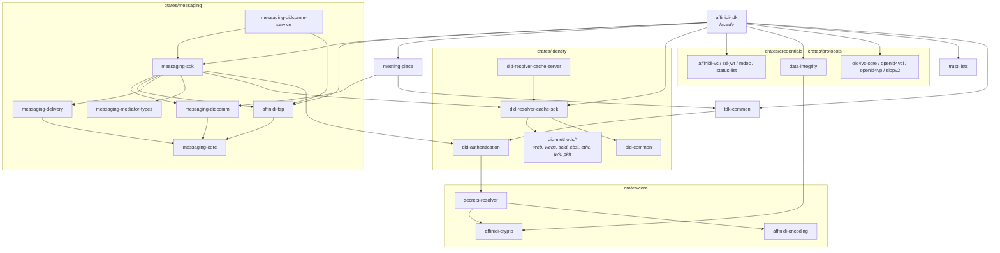

# Affinidi Trust Development Kit (TDK) for Rust

[](https://github.com/affinidi/affinidi-tdk-rs)
[](LICENSE)
[](https://github.com/affinidi/affinidi-tdk-rs/issues)

A Rust workspace for building secure, privacy-preserving applications using
decentralised identity technologies. The TDK provides libraries and tools for
DID resolution, DIDComm messaging, data integrity proofs, cryptographic
primitives, and more.

> **Disclaimer:** This project is provided "as is" without warranties or
> guarantees. By using this framework, users agree to assume all risks
> associated with its deployment and use, including implementing security and
> privacy measures in their applications. Affinidi assumes no liability for any
> issues arising from the use or modification of the project.

## Workspace Overview

The workspace is organised into dependency layers under `crates/`: `core` →
`identity` → `credentials` / `protocols` / `messaging` → `trust` →
`applications`, with the `tdk` facade on top. The graph shows the main
dependency paths; the [crate index](#crate-index) lists every member.



The mediator (`affinidi-messaging-mediator`, `-mediator-common`, the
`affinidi-messaging-test-mediator` fixture, and the `-mediator-admin` /
`-mediator-tui` console) lives in its own repository:
[affinidi/affinidi-messaging-mediator](https://github.com/affinidi/affinidi-messaging-mediator).

## Crate Index

Every workspace member, generated from `cargo metadata`. Crates marked *not
published* are workspace tools and never reach crates.io.

### [TDK facade](./crates/tdk/)

[`affinidi-tdk`](./crates/tdk/affinidi-tdk/) re-exports the TDK libraries
behind feature flags so you can depend on one crate and enable only what you
need.

| Crate | Description |
|---|---|
| [`affinidi-tdk`](./crates/tdk/affinidi-tdk/) | Facade re-exporting the TDK behind capability features |
| [`affinidi-tdk-common`](./crates/tdk/affinidi-tdk-common/) | Shared structs, TLS config, and cross-crate utilities |
| [`affinidi-tdk-test-support`](./crates/tdk/affinidi-tdk-test-support/) | In-process test fixtures: did:web mocks, deterministic resolvers, seeded DIDs, credential scenarios |

### [Core](./crates/core/)

Foundational primitives with no domain dependencies.

| Crate | Description |
|---|---|
| [`affinidi-bbs`](./crates/core/affinidi-bbs/) | BBS Signatures (IETF draft) over BLS12-381 |
| [`affinidi-cesr`](./crates/core/affinidi-cesr/) | CESR (Composable Event Streaming Representation) codec |
| [`affinidi-crypto`](./crates/core/affinidi-crypto/) | Cryptographic primitives and JWK types — Ed25519, P-256, secp256k1 |
| [`affinidi-encoding`](./crates/core/affinidi-encoding/) | Multibase and multicodec encoding utilities |
| [`affinidi-net-guard`](./crates/core/affinidi-net-guard/) | Egress guard for attacker-influenceable URLs: IP classification, URL vetting, a DNS-pinning resolver and a hardened HTTP client |
| [`affinidi-rate-limit`](./crates/core/affinidi-rate-limit/) | Request rate limiting for axum services: per-IP middleware and keyed limiters |
| [`affinidi-secrets-resolver`](./crates/core/affinidi-secrets-resolver/) | DID secret management and key resolution |
| [`affinidi-task-utils`](./crates/core/affinidi-task-utils/) | Background-task supervision with restart-on-failure and an observable health registry |

### [Identity & DID Resolution](./crates/identity/)

DID Document types and high-performance resolution with local and network
caching (250k+ resolutions/sec cached).

| Crate | Description |
|---|---|
| [`affinidi-did-authentication`](./crates/identity/affinidi-did-authentication/) | Authentication via proof of DID ownership |
| [`affinidi-did-common`](./crates/identity/affinidi-did-common/) | DID Document types, builders, and common utilities |
| [`affinidi-did-resolver-cache-sdk`](./crates/identity/affinidi-did-resolver-cache-sdk/) | SDK for local and network DID resolution with caching |
| [`affinidi-did-resolver-cache-server`](./crates/identity/affinidi-did-resolver-cache-server/) | Standalone network DID resolution server |
| [`affinidi-did-resolver-traits`](./crates/identity/affinidi-did-resolver-traits/) | Pluggable resolver traits for custom DID methods |
| [`did-ebsi`](./crates/identity/did-methods/did-ebsi/) | `did:ebsi` method for legal entities |
| [`affinidi-did-ethr`](./crates/identity/did-methods/did-ethr/) | `did:ethr` DID method resolver |
| [`did-example`](./crates/identity/did-methods/did-example/) | `did:example` method for testing |
| [`affinidi-did-jwk`](./crates/identity/did-methods/did-jwk/) | `did:jwk` DID method resolver |
| [`affinidi-did-pkh`](./crates/identity/did-methods/did-pkh/) | `did:pkh` DID method resolver |
| [`did-scid`](./crates/identity/did-methods/did-scid/) | `did:scid` Self-Certifying Identifier method |
| [`affinidi-did-web`](./crates/identity/did-methods/did-web/) | `did:web` DID method resolver |
| [`affinidi-did-webs`](./crates/identity/did-methods/did-webs/) | `did:webs` — did:web discovery with KERI-verified key state |
| [`agent-names`](./crates/identity/shortcuts/agent-names/) | Agent Name (DID shortcut) parsing, resolution and verification |

### [Credentials](./crates/credentials/)

W3C Verifiable Credentials and selective-disclosure formats.

| Crate | Description |
|---|---|
| [`affinidi-data-integrity`](./crates/credentials/affinidi-data-integrity/) | W3C Data Integrity proofs (eddsa-jcs-2022, eddsa-rdfc-2022) |
| [`affinidi-mdoc`](./crates/credentials/affinidi-mdoc/) | ISO/IEC 18013-5 mdoc (mobile driving licences, eIDAS attestations) |
| [`affinidi-rdf-encoding`](./crates/credentials/affinidi-rdf-encoding/) | RDFC-1.0 canonicalization and JSON-LD expansion |
| [`affinidi-sd-jwt`](./crates/credentials/affinidi-sd-jwt/) | SD-JWT (Selective Disclosure JWT) per RFC 9901 |
| [`affinidi-status-list`](./crates/credentials/affinidi-status-list/) | Credential status and revocation lists (Bitstring Status List, IETF Token Status List, eIDAS ASL/ARL) |
| [`affinidi-vc`](./crates/credentials/affinidi-vc/) | W3C Verifiable Credentials Data Model 1.1 and 2.0 |

### [Protocols](./crates/protocols/)

OpenID for Verifiable Credentials (OID4VC) protocol family.

| Crate | Description |
|---|---|
| [`affinidi-oid4vc-core`](./crates/protocols/affinidi-oid4vc-core/) | Shared types for the OID4VC protocol family |
| [`affinidi-openid4vci`](./crates/protocols/affinidi-openid4vci/) | OpenID for Verifiable Credential Issuance (OpenID4VCI) — draft-13 message types |
| [`affinidi-openid4vp`](./crates/protocols/affinidi-openid4vp/) | OpenID for Verifiable Presentations (OpenID4VP) |
| [`affinidi-siopv2`](./crates/protocols/affinidi-siopv2/) | Self-Issued OpenID Provider v2 (SIOPv2) |

### [Messaging](./crates/messaging/)

Secure, private messaging built on
[DIDComm v2](https://identity.foundation/didcomm-messaging/spec/) and
[TSP](https://trustoverip.github.io/tswg-tsp-specification/).

| Crate | Description |
|---|---|
| [`affinidi-messaging-core`](./crates/messaging/affinidi-messaging-core/) | Protocol-agnostic messaging traits |
| [`affinidi-messaging-delivery`](./crates/messaging/affinidi-messaging-delivery/) | Reliable delivery layer: durable outbox and drain over the `MessageTransport` trait |
| [`affinidi-messaging-didcomm`](./crates/messaging/affinidi-messaging-didcomm/) | DIDComm v2.1 protocol implementation |
| [`affinidi-messaging-didcomm-service`](./crates/messaging/affinidi-messaging-didcomm-service/) | Always-online service framework: mediator connection, message lifecycle and handler dispatch for DIDComm, with TSP multiplexed behind the `tsp` feature (`AffinidiMessageService`) |
| [`affinidi-messaging-didcomm-v1`](./crates/messaging/affinidi-messaging-didcomm-v1/) | DIDComm v1 (Aries RFC 0019) messaging implementation |
| [`affinidi-messaging-helpers`](./crates/messaging/affinidi-messaging-helpers/) | Example runners and mediator-administration CLI tools (environment files are hand-written; see its README) — *not published* |
| [`affinidi-messaging-mediator-types`](./crates/messaging/affinidi-messaging-mediator-types/) | Protocol types shared by the mediator and its clients |
| [`affinidi-messaging-sdk`](./crates/messaging/affinidi-messaging-sdk/) | SDK for integrating Affinidi Messaging into your application |
| [`affinidi-messaging-text-client`](./crates/messaging/affinidi-messaging-text-client/) | Terminal-based DIDComm chat client — *not published* |
| [`affinidi-tsp`](./crates/messaging/affinidi-tsp/) | Trust Spanning Protocol (TSP) with HPKE-Auth encryption |

### [Trust](./crates/trust/)

| Crate | Description |
|---|---|
| [`affinidi-trust-lists`](./crates/trust/affinidi-trust-lists/) | EU Trusted Lists (ETSI TS 119 612) for eIDAS 2.0 trust infrastructure |

### [Applications](./crates/applications/)

| Crate | Description |
|---|---|
| [`affinidi-meeting-place`](./crates/applications/affinidi-meeting-place/) | Discover and connect with others using DIDs and DIDComm, securely and privately |

## Requirements

- **Rust** 1.95.0+ (2024 Edition). The workspace MSRV is `rust-version` in
  [`Cargo.toml`](./Cargo.toml); `scripts/check-toolchain-sync.sh` keeps this
  line and the badges in step with it.

## Quick Start

Add the unified TDK crate to your project (cargo picks the latest release):

```bash
cargo add affinidi-tdk
```

Or depend on individual crates for finer control:

```bash
cargo add affinidi-did-resolver-cache-sdk affinidi-messaging-sdk affinidi-data-integrity
```

All crates are 0.x: a minor bump is a breaking release, so keep every
affinidi-* dependency on the versions `cargo add` resolves together rather than
mixing in older pins.

### Resolve a DID

[`crates/tdk/affinidi-tdk/examples/resolve_did.rs`](./crates/tdk/affinidi-tdk/examples/resolve_did.rs)
(built in CI, so it tracks the current API):

```rust
use affinidi_tdk::did_resolver::{DIDCacheClient, config::DIDCacheConfigBuilder};

// Local-mode resolver: did:key / did:peer resolve with no network.
let resolver = DIDCacheClient::new(DIDCacheConfigBuilder::default().build()).await?;
let response = resolver.resolve("did:key:z6MkiToqovww7vYtxm1xNM15u9JzqzUFZ1k7s7MazYJUyAxv").await?;
println!("{}", serde_json::to_string_pretty(&response.doc)?);
```

```bash
cargo run -p affinidi-tdk --example resolve_did -- \
  did:key:z6MkiToqovww7vYtxm1xNM15u9JzqzUFZ1k7s7MazYJUyAxv
```

### Authenticate and send DIDComm messages

- [`crates/tdk/affinidi-tdk/examples/did_auth.rs`](./crates/tdk/affinidi-tdk/examples/did_auth.rs)
  — DID authentication against a service through the facade.
- The [messaging SDK README](./crates/messaging/affinidi-messaging-sdk/README.md)
  covers creating an `ATM`, adding a profile and connecting to a mediator; the
  runnable [messaging helpers examples](./crates/messaging/affinidi-messaging-helpers/examples/)
  (`trust_ping`, `mediator_ping`, `alice_bob`, `oob_invite`) send real messages
  through a mediator.

## Testing

You can write messaging / DID / credential integration tests with **no external
infrastructure** — no Redis, no network, no standing services. Two paths:

- **Rust fixtures** — pull a fixture crate in as a `dev-dependency`:
  [`affinidi-messaging-test-mediator`](https://github.com/affinidi/affinidi-messaging-mediator)
  (in the mediator's repository) for embedded mediators (`TestMediator` /
  `TestEnvironment` / `TestTopology`), and
  [`affinidi-tdk-test-support`](./crates/tdk/affinidi-tdk-test-support/) for
  did:web mocks, deterministic resolvers, seeded DIDs, and credential scenarios.
  A mediator is three lines; an issue/present/verify round trip is a handful.
- **Language-agnostic** — the mediator repository's composed test stack
  (`docker-compose.test.yml`) brings up a known-good mediator + Redis + did:web
  host with fixed TEST-ONLY identities for any client to point at.

Copy-paste scenarios are in the [testing cookbook](./docs/testing/cookbook.md).

## Using affinidi-* crates from outside this workspace

This workspace's root [`Cargo.toml`](./Cargo.toml) defines a non-trivial
`[patch.crates-io]` table that redirects every workspace crate to its local
source. Cargo's patch tables are only honoured by the workspace that *defines*
them — when an external repository depends on any affinidi-* crate via a git
rev or local path, that consumer must replicate the same patch table, or
different parts of the dependency closure will end up resolving the affinidi-*
crates from a mix of crates.io and the git/path source. Type-graph divergence
shows up as confusing trait mismatches at compile time (`expected
MediatorACLSet, found MediatorACLSet`).

This is a known cargo limitation — see
[rust-lang/cargo#4452](https://github.com/rust-lang/cargo/issues/4452).

### Recommended path: depend on crates.io releases

The simplest approach is to depend on published versions only, added together
so they come from the same release wave:

```bash
cargo add affinidi-tdk affinidi-messaging-sdk
cargo add --dev affinidi-messaging-test-mediator
```

No patch table is needed — cargo resolves a single version of each affinidi-*
crate from crates.io and the type graph is unified by construction. If cargo
reports two versions of the same affinidi-* crate (`cargo tree -d`), one of
your pins is a stale 0.x minor: raise it rather than adding a patch.

### When you must use a git rev (unreleased fixes)

If you need a change that hasn't reached crates.io yet, pin the affinidi-*
crates you use to one git rev, *and* mirror the workspace's patch table so
transitive dependencies go through the same rev. Generate the block for a
given commit — it reads the live table, so it never drifts:

```bash
./tools/generate-consumer-patch.sh <git-rev>
```

Paste the output into your own `Cargo.toml`. The rev must match — and stay
matched — to the version constraints in your own `[dependencies]`; when you
bump an affinidi-* dependency, regenerate the block for the new rev.

## Support & Feedback

If you face any issues or have suggestions, please don't hesitate to contact us
using [this link](https://share.hsforms.com/1i-4HKZRXSsmENzXtPdIG4g8oa2v).

### Reporting Technical Issues

If you have a technical issue, you can
[open an issue](https://github.com/affinidi/affinidi-tdk-rs/issues/new) directly
in GitHub. Please include a **title and clear description**, as much relevant
information as possible, and a **code sample** or **executable test case**
demonstrating the expected behaviour.

## Contributing

Want to contribute? Head over to our
[CONTRIBUTING](https://github.com/affinidi/affinidi-tdk-rs/blob/main/CONTRIBUTING.md)
guidelines.

## License

This project is licensed under the [Apache-2.0](LICENSE) license.
